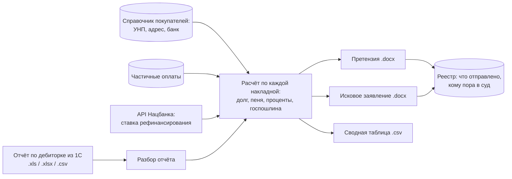

# Debt Claims Generator

Программа, которая берёт из 1С отчёт о дебиторской задолженности и сама готовит **претензии и исковые заявления** по каждому просроченному договору: с расчётом пени, процентов по ст. 366 ГК РБ, госпошлины и с учётом частичных оплат.


> Все данные в репозитории **вымышленные**: истец «Ромашка», покупатели «СтальТрейд», «АвтоЗавод» и другие, реквизиты, суммы и номера договоров. Реальные выгрузки, договоры и справочник покупателей в репозиторий не входят.

## Содержание

- [Зачем это нужно](#зачем-это-нужно)
- [Как это работает](#как-это-работает)
- [Как считаются суммы](#как-считаются-суммы)
- [Возможности](#возможности)
- [Быстрый старт](#быстрый-старт)
- [Работа в окне программы](#работа-в-окне-программы)
- [Командная строка](#командная-строка)
- [Настройка](#настройка)
- [Структура проекта](#структура-проекта)
- [Тесты](#тесты)

## Зачем это нужно

У оптовой компании десятки покупателей, которые платят с опозданием, у многих — по нескольку договоров и накладных. Чтобы взыскать долг, юрист для каждого договора:

1. находил просрочку в отчёте 1С;
2. считал пеню по каждой накладной по ставке из договора;
3. считал проценты за пользование чужими деньгами по ставке рефинансирования Нацбанка, которая за период могла меняться несколько раз;
4. учитывал частичные оплаты — каждая погашенная часть считается до своей даты;
5. переписывал реквизиты покупателя из договора;
6. собирал претензию, а если должник не платил — исковое заявление.

Всё это делалось вручную в Word и калькуляторе. Ошибка в расчёте означает, что суд уменьшит требования или вернёт иск.

Программа повторяет работу юриста: расчёты и тексты документов построены по реальным образцам его исков и сверены с ними до копейки.

## Как это работает



1. **Загрузка отчёта.** Программа читает выгрузку «Отчёт по дебиторской задолженности» из 1С и группирует строки по покупателям, договорам и накладным.
2. **Определение типа договора** по его номеру:
   - **биржевой** (через товарную биржу, номер вида `01/XXXXX-XXX`) — иск подаётся в арбитражную комиссию биржи;
   - **прямой** — иск подаётся в экономический суд.

   От типа зависят ставка пени, пункты договора, на которые ссылается документ, и список приложений к иску.
3. **Расчёт** долга, пени, процентов и госпошлины по каждой накладной.
4. **Генерация документов** по выбранным договорам: претензия и (или) исковое заявление в формате Word.
5. **Реестр** запоминает, что сформировано и отправлено, и подсказывает, по каким договорам срок ответа на претензию истёк и можно подавать в суд.

## Как считаются суммы

### Пеня
- Ставка зависит от типа договора: **0,1 % в день** для биржевых и **0,5 % в день** для прямых. Для отдельного покупателя её можно переопределить в справочнике.
- Пеня считается **не более чем за 1095 дней** — это общий срок исковой давности (ст. 197 ГК РБ). Без ограничения пеня по старым долгам в разы превышала бы сам долг, а суд такое не взыщет. В документе такие строки помечаются.

### Проценты по ст. 366 ГК РБ
- Считаются по ставке рефинансирования Национального банка, **действовавшей в каждый отрезок периода**. Если ставка внутри периода менялась, период разбивается по датам её изменения.
- Формула: `сумма × ставка % / 360 × дни`.
- История ставки хранится в `data/refinancing_rate.csv`. Её можно обновить кнопкой в окне программы: данные скачиваются с открытого API Нацбанка (`api.nbrb.by`). Кроме того, программа сама тихо проверяет ставку раз в сутки при запуске. Наружу уходит только запрос на чтение, без каких-либо данных.
- Начисление процентов можно отключить одной настройкой.

### Частичные оплаты
В отчёте 1С виден только остаток долга, а когда и сколько покупатель уже заплатил — нет. Платежи вносятся в окне программы, и пеня разбивается по частям: каждая погашенная часть «живёт» до своей даты оплаты, день оплаты в просрочку не входит.

```
долг по накладной 10 000,00, просрочка с 28.01, ставка 0,1 % в день

06.02 п/п №101 оплачено 3 000,00  ->  28.01–05.02 =  9 дн.  ->   27,00
09.02 п/п №102 оплачено 2 000,00  ->  28.01–08.02 = 12 дн.  ->   24,00
остаток         5 000,00          ->  28.01–18.02 = 22 дн.  ->  110,00
                                                     итого пени: 161,00
```

### Госпошлина и арбитражный сбор
Ставки и базовая величина лежат в `data/tariffs.json`. Пока в файле стоит `"проверено": false`, сумма госпошлины **не печатается** в иске (остаётся общая фраза), а в сводной таблице показывается как ориентировочная. Так в суд не уйдёт документ с непроверенной цифрой.

## Возможности

- **Разбор отчёта 1С** в форматах `.xls`, `.xlsx`, `.csv`. Учтены особенности реальной выгрузки: старый `.xls` без указания кодировки, разные написания «Договор №» и «Договор N», контрагент и договор в одной ячейке через перенос строки.
- **Претензии и иски в Word** по структуре и формулировкам образцов юриста. Если на компьютере установлен Word, программа считает настоящее количество листов иска для списка приложений.
- **Реквизиты покупателя из договора.** Загружаете договор (`.docx`, `.doc`, `.rtf` или `.pdf` с текстом) — программа отделяет сторону покупателя от реквизитов истца и достаёт наименование, УНП, юридический адрес, расчётный счёт, банк, код банка, телефон и подписанта. Распознаёт даже счета, в которых латинские буквы набраны похожими русскими. После проверки данные записываются в справочник; уже заполненное вручную не затирается.
- **Реестр отправки:** претензия сформирована → отправлена → ждём ответа (10 дней) → срок истёк, можно в суд. При загрузке нового отчёта программа видит, что долг оплачен полностью или частично.
- **Предупреждения о рисках** перед формированием документов:
  - у покупателя не заполнены реквизиты;
  - просрочка больше 3 лет — возможен пропуск срока исковой давности;
  - долг меньше 100 руб. — иск обойдётся дороже самого долга.
- **Сводная таблица** по всем делам: долг, пеня, проценты, итог, госпошлина, флаги риска.
- **Всё работает локально.** Интерфейс открывается в браузере, но сервер запущен только на вашем компьютере (`127.0.0.1`), данные никуда не отправляются.

## Быстрый старт

Нужен Python 3.10 или новее.

```bash
git clone https://github.com/bachaa7/debt-claims-generator.git
cd debt-claims-generator
pip install -r requirements.txt

python web.py                      # откроется окно программы в браузере
```

На Windows программу можно запускать двойным щелчком по `Претензии.bat`.

Для проверки в репозитории есть демо-отчёт [`examples/Отчет_пример.xlsx`](examples/Отчет_пример.xlsx): 9 строк долга, 6 покупателей, среди них биржевые и прямые договоры, мелкий долг и долг с истёкшим сроком давности.

## Работа в окне программы

1. **Выберите отчёт** — например, `examples/Отчет_пример.xlsx`. Укажите порог просрочки в днях (по умолчанию 5) и дату, на которую считать пеню.
2. Нажмите **«Показать должников»**. Появится таблица: покупатель, договор, тип, дни просрочки, количество накладных, сумма долга, состояние претензии и предупреждения. Есть поиск, сортировка по столбцам и быстрые фильтры: «Готовы к иску», «Без реквизитов», «Срок давности > 3 лет».
3. **Отметьте нужные договоры** и нажмите **«Сделать претензии»** или **«Сделать иски»**. Если среди отмеченных есть рискованные, программа предупредит и даст отменить.
4. Готовые файлы раскладываются по покупателям, кнопка **«Открыть папку»** покажет их.

Там же в окне:
- **«Реквизиты покупателей из договора»** — загрузка договора и запись реквизитов в справочник;
- **«Частичные оплаты по накладным»** — дата, сумма, номер платёжки, назначение платежа;
- **«Отметить отправленными»** — от этой даты отсчитывается срок ответа на претензию;
- **«Обновить ставку НБ РБ»**.

## Командная строка

Всё то же можно делать без окна:

```bash
# список должников
python main.py list --report examples/Отчет_пример.xlsx

# претензии по всем договорам с просрочкой от 5 дней
python main.py pretenzii --report examples/Отчет_пример.xlsx --min-days 5

# претензия по одному договору
python main.py pretenzii --report examples/Отчет_пример.xlsx --contragent "СтальТрейд" --contract "020726/2"

# отметить претензии покупателя отправленными
python main.py mark-sent --report examples/Отчет_пример.xlsx --contragent "СтальТрейд" --sent-date 20.07.2026

# иски только по тем, у кого истёк срок ответа на претензию и долг не оплачен
python main.py iski --report examples/Отчет_пример.xlsx --ready-for-suit

# состояние реестра
python main.py journal --report examples/Отчет_пример.xlsx

# обновить ставку рефинансирования
python main.py update-rate
```

Дополнительные параметры: `--as-of ДД.ММ.ГГГГ` — дата расчёта, `--out папка` — куда сохранять документы.

Результат:

```
output/
├── СтальТрейд/
│   ├── pretenzii/pretenzia__010726-1.docx
│   └── iski/isk__010726-1.docx
├── АвтоЗавод/
│   └── ...
├── _summary_pretenzii.csv
└── _summary_iski.csv
```

## Настройка

| Файл | Что настраивается |
|---|---|
| `company.py` | реквизиты истца, ставки пени по умолчанию, сроки оплаты, пункты договоров, куда подаётся спор, состав приложений к иску, порог мелкого долга, начислять ли проценты по ст. 366 |
| `data/tariffs.json` | базовая величина, ставки госпошлины и арбитражного сбора |
| `data/refinancing_rate.csv` | история ставки рефинансирования (обновляется автоматически) |
| `data/contragents.csv` | справочник покупателей: УНП, адрес, банк, подписант, своя ставка пени. Создаётся и пополняется программой при загрузке отчёта |

Рабочие файлы (`data/contragents.csv`, `data/journal.csv`, `data/payments.csv`, `data/contracts/`, `output/`) создаются при работе и в репозиторий не попадают — в них реальные данные компании.

## Структура проекта

```
web.py                         локальный сервер окна программы
templates/index.html           интерфейс (HTML, CSS, JavaScript)
main.py                        командная строка и отбор договоров
parser.py                      разбор отчёта 1С
docgen.py                      генерация претензий и исков (.docx)
rates.py                       ставка рефинансирования, проценты ст. 366, госпошлина
payments.py                    частичные оплаты
journal.py                     реестр отправки
contracts.py                   извлечение реквизитов из договоров
company.py                     настройки и реквизиты истца
build_contragents_template.py  создание и пополнение справочника покупателей
data/                          ставки и тарифы
examples/                      демо-отчёт 1С
tests/                         тесты
Претензии.bat                  запуск двойным щелчком (Windows)
```

## Тесты

```bash
python tests/control_set.py                                # расчёт на 7 договорах с заранее посчитанными ответами
python tests/web_api.py examples/Отчет_пример.xlsx         # проверка всех кнопок окна программы
```

`control_set.py` проверяет долг, пеню, проценты и итог по договорам с разными ситуациями: прямой и биржевой договор, частичные оплаты, несколько накладных по одному договору, мелкий долг и долг старше 3 лет.

## Правовая основа

Статьи 197, 290, 311, 314, 366, 456, 486 Гражданского кодекса Республики Беларусь. Перед реальным применением тексты шаблонов нужно согласовать с юристом.
